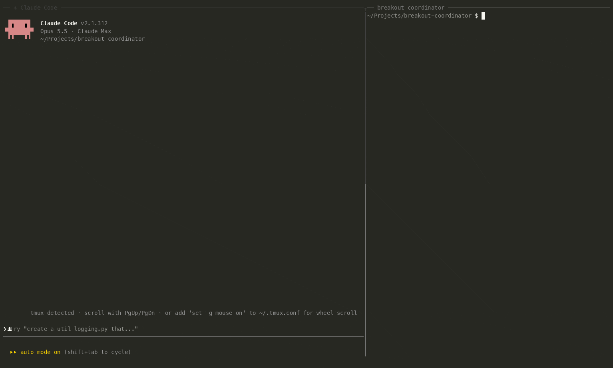

# breakout-coordinator

[](https://github.com/saranyan/breakout-coordinator/actions/workflows/tests.yml)

You're coding or designing with Claude or Codex, and you want a few agents to go
discuss something and come back with answers. This does that.

Ask from your conversation ("break out on this design with an architect and a
skeptic"). The agents go off, argue it out, and the answer comes back to the same
conversation. You can then ask them follow-up questions or ask for changes. Mix
vendors freely: Claude, Codex, or any OpenAI-compatible model. Your agent passes
them the context, so you don't have to.



*A real breakout from a Claude Code conversation: an Architect (Claude) and Sol (Codex)
review this README. The right pane is `breakout watch`. Waits are sped up.*

## Try it

```sh
git clone https://github.com/saranyan/breakout-coordinator.git && cd breakout-coordinator
python3 -m breakout demo --document examples/review.txt   # pretend agents, no accounts
```

Python 3.11+, macOS. No dependencies.

## Use it

```sh
python3 -m venv .venv && .venv/bin/pip install -e . && export PATH="$PWD/.venv/bin:$PATH"
breakout install --provider claude --config-dir ~/.claude
breakout install --provider codex --config-dir ~/.codex
breakout daemon start
```

Restart your session and ask for a breakout. See the [guide](docs/GUIDE.md).

## Good to know

- Agents only discuss. They can't run commands or edit your files.
- Answers show up at your next message, not instantly.
- Tested live from both Claude and Codex, with Claude + Codex agents. Other paths
  are covered by tests only; see [verification](docs/VERIFICATION.md).
- Next up: agents that build and test code, not just talk.
  See the [roadmap](ROADMAP.md).

[Reference](docs/REFERENCE.md) · [Contributing](CONTRIBUTING.md) ·
[Security](SECURITY.md) · [MIT license](LICENSE)

Sibling project: [agent-relay](https://github.com/saranyan/agent-relay), which
lets two coding sessions pass work back and forth.
