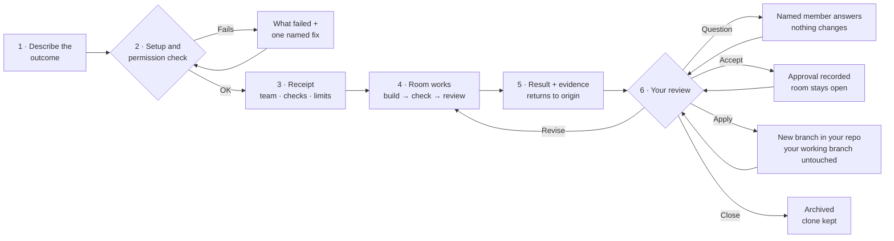
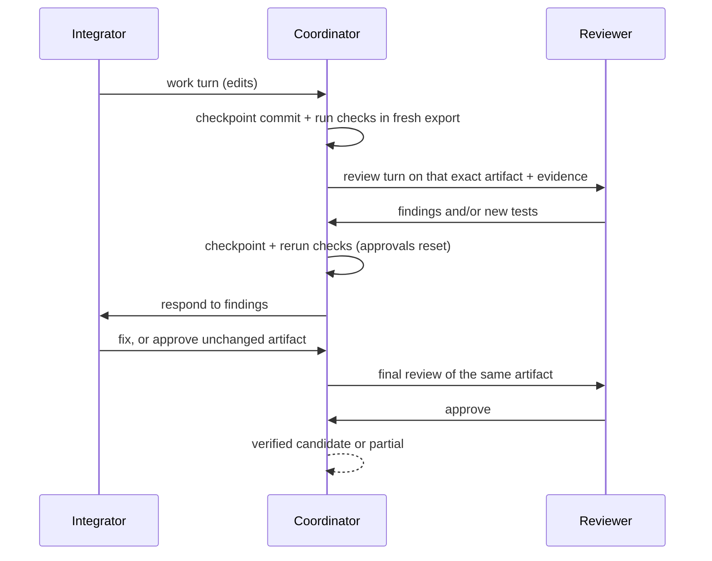
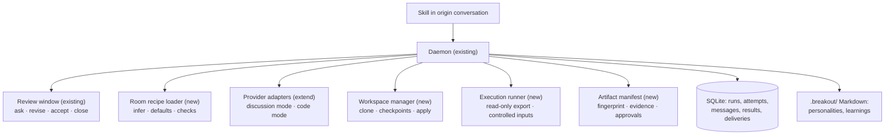
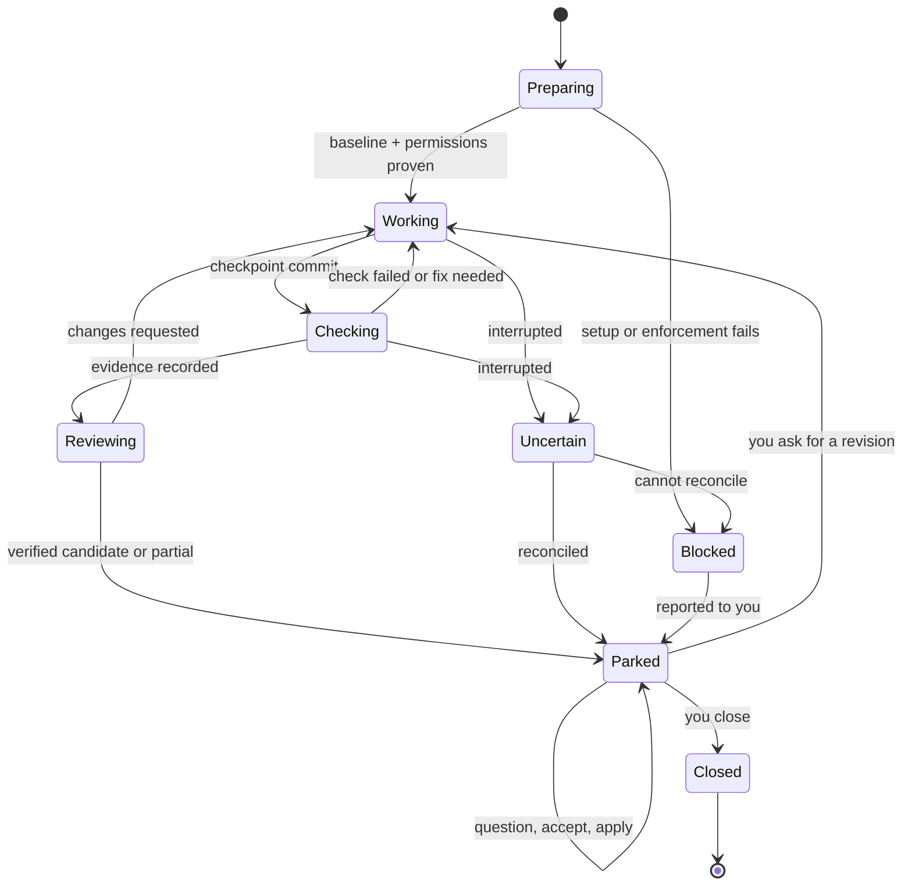
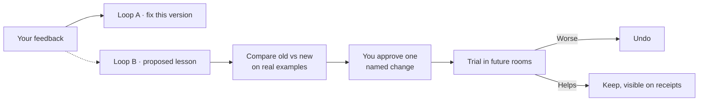

# Breakout Rooms: local rooms for research, design and software prototypes

> **Status: proposed, not built.** This is the design for the next stage of breakout-coordinator. Nothing here about rooms that edit or run code is implemented. Section 3 separates what works today from what's proposed. It was itself written in a breakout (see [how this design was made](#how-this-design-was-made)), and agreement between the agents who wrote it is not evidence that any of it works.

Start with §1 (the idea), §4 (the experience), and §16 (open questions). The technical contract and implementation gates follow for detailed review.

---

## 1. The proposal in one minute

You are working in a Claude or Codex conversation (the **origin**). You say: *"Have Architect and Sol prototype CSV import validation. Bring me something I can run."*

Breakout opens a **room**: a small, temporary team of agents working in the background on one job. When the job is done, the result comes back to the same conversation. For a prototype that means: a branch you can import into your repository, a diff, the test results the coordinator actually observed on that exact code, and the choices left for you. You can ask a member a question, ask for a revision, accept the result, and close the room when you are finished.

**You describe the outcome. The origin fills in the rest.** It works out the kind of room (research, design or prototype), uses your project's saved team defaults or the members you named, and finds likely checks in the repository (for example, an existing test suite). All of it appears on a short receipt before work starts. The origin asks you only when something consequential is missing, such as which repository, or if no way to check the code can be found.

Under the hood a room is a **recipe**: a versioned set of defaults over the existing coordinator. It is not a new service and not an autonomous organisation.

**First release scope:** prototype rooms using the installed, logged-in **Claude and Codex CLIs only**. Research and design rooms reuse today's discussion workflow. API and Hugging Face workers come later.

---

## 2. Why rooms, and when not to use one

**The problem.** Asking several agents for help makes you the messenger. You copy context, compare replies, move files, run tests and explain the changes again. Breakout takes over that coordination and keeps the evidence.

**Use a room when** the task benefits from a second perspective, an independent test, or a bounded experiment you want to inspect before it touches your work.

**Skip the room when** the change is small and clear. One agent is often enough and avoids the extra coordination. More agents cost more, can take longer, and can share the same wrong assumption. **Agreement between agents is a coordination signal, never proof of correctness.**

**How we will know rooms help.** On matched tasks, a room is compared with the origin working alone. Measures: your correction effort, real defects found, requirements kept, elapsed time and reported usage. A first small baseline runs alongside the first live pilot (Stage 4), so the result can shape the build. A fuller comparison follows in Stage 6. CLI token cost is currently unknown, and we will say so rather than guess. A room earns its place only if the extra coordination pays off.

---

## 3. What works today, and what this RFC adds

Status as of 2026-10-16. The current picture is in [verification](../VERIFICATION.md).

| Capability | Status | Evidence / limit |
| --- | --- | --- |
| Codex origin → Claude Opus Architect (brief) + Codex Sol (native fork): discussion, user question, user revision, reviewed artifact, explicit close | 🟢 **Live verified** | Closed after 9 work turns plus 2 review replies, with a user question, a user revision, a reviewed artifact and an explicit close |
| Review window: park, targeted questions, revision with re-approval of the exact version, accept ≠ close, budgets, repeated messages applied only once | 🟢 Live for the path above · 🟡 the rest by automated tests | Restart while parked, reconciling uncertain outcomes, timeouts and extensions are covered by automated tests only |
| Claude as origin | 🟡 **Automated only** | All four origin/team combinations pass with deterministic agents; not run live |
| Teams of 3–4, advisory members, author other than the first member | 🟡 **Automated only** | Not run live |
| Team definitions in the access map resolving to 2–4 members | 🟢 Two-member recipe used live · 🟡 larger teams automated only | This RFC room launched from the project recipe. Room recipes (type + capabilities + checks) as described here are **not built** |
| Personalities and learnings as versioned project Markdown, pinned per run, with trial and undo | 🟡 **Automated only** | No improvement from learning has been measured |
| OpenAI-compatible HTTP adapter | ⚪ **Mocked transport only** | Not live API evidence. Out of v3 scope |
| Waking an idle conversation when a result is ready | ⚪ **Not verified** | Results appear at your next turn, or when you ask |
| Worker tool use | **Deliberately disabled** | Codex adapter is read-only with shell and MCP disabled. Claude has tools disabled and runs in plan mode |
| Prototype rooms: code edits, local Git, coordinator-run checks, evidence | 🔶 **Proposed in this RFC** | Not implemented |
| Competing implementations in parallel clones | 🔶 Proposed later | After one shared clone is reliable |

---

## 4. User journey: a prototype room, start to finish

A worked example. The receipt and result wording show the proposed format. No such run has happened.



**1. Describe.** *"Have Architect and Sol prototype CSV import validation in `~/proj`. Keep it local."* You don't need to know the test command. The origin finds `tests/` and proposes running it.

**2. Check.** Breakout confirms four things: the repository is committed and clean; the needed CLIs are installed and logged in; the requested models and options are accepted; and the permission boundary for prototype rooms passed its enforcement checks (§9). If any check fails, you get what is known and one named fix, and nothing starts.

**3. Receipt.**
> Room `csv-import-…` (prototype) started.
> Team: Architect · claude-opus-5-5 medium · integrator. Sol · gpt-6.1-sol medium · reviewer (tests and findings).
> Repo: `~/proj` @ `a1b2c3d` (clean) → private clone, room branch `room/csv-import-…`.
> Allowed: edit files in the clone; run commands in the clone, network off. Not allowed: push, publish, install, MCP, starting other agents.
> Checks (found in repo): `python3 -m unittest discover -s tests`. Acceptance: your request + the CSV cases listed below.
> Limits: 6 rounds (one turn per member each, so up to 12 work turns), 15 active minutes, 10 review replies. Results return here.

Starting the room authorizes running **exactly the checks shown**, inside the boundary. Text in the repository never grants any other permission. If no check can be found, the origin asks you, or the room runs with test state *unavailable* and can return only **Partial**.

**4. Work.** Status shows *building*, *checking*, *reviewing*, *blocked* or *waiting for you*. Turns take place one at a time in a single clone (§6).

**5. Result.**
> Room `csv-import-…` result r3. **Verified candidate**: both required members approved artifact `9f…` (commit `d4e5f6a`). Required check passed on exactly that artifact (coordinator-run in a fresh export, exit 0, log hash `…`). Sol added 2 regression tests; one failed on the base commit and passes now. Non-blocking suggestion: also accept semicolon delimiters. Nothing has been applied to your repository.

A blocking question still open (for example, *"is an empty file an error?"*, when that behaviour is part of the acceptance criteria) would make this **Partial**, not verified. Every shortfall is named: check failing, check missing, member unavailable, disagreement open.

**6. Review.** *"Sol, why reject BOMs?"* gets an answer and changes nothing; a question can never start edits or checks. *"Revise: accept semicolons too"* sends the team back to work, and approvals of the old version stop counting. *"Accept r3"* records approval only. *"Apply r3"* imports the approved commit into your repository as a **new** branch, `breakout/csv-import-…`, without switching or changing your working branch. Merging, pushing and opening a pull request stay your actions. *"Close the room"* stops the team. The record, evidence and clone remain. Deleting the clone is a separate cleanup request.

---

## 5. Room types and what each may do

| Room | Job | Access by default | Returns |
| --- | --- | --- | --- |
| **Research** | Compare explanations or approaches | Only sources and snapshots you supply | Findings with source references, uncertainty, next experiment |
| **Design** | Turn a problem into a reviewable decision | Supplied sources and snapshots | RFC, alternatives, diagrams, decisions for you |
| **Prototype** | Build and test one bounded software change | One private clone; edits and commands inside it; network off | Commit(s), diff, run command, coordinator-observed check results, limits |

Rules:

- **A name never grants a capability.** "Research" does not mean web browsing. Browsing, document connectors, network access and publishing are separate capabilities, and none of them is in v3. Research rooms are therefore limited to what you supply, and the receipt says so.
- A recipe *requests* capabilities. The coordinator grants only what you authorized for this task **and** what the installed CLI is proven to enforce (§9). A personality never changes permissions, model or role.
- First release: three built-in recipes and a small declarative schema. Unknown fields fail before any worker starts. No plugin marketplace and no executable room scripts.

---

## 6. Teams and how they work together

- **Size:** 2 members by default, up to 4. Live coverage beyond 2 members is labelled separately until it has actually run.
- **Providers:** Claude CLI and Codex CLI only. A mixed team needs both CLIs installed and logged in; a same-provider team needs only its own. Several members on one CLI are separate persistent sessions with distinct names and personalities.
- **Models:** requested model IDs and effort are used exactly as given, with no fallback and no silent substitution. The default pair keeps `claude-opus-5-5` and `gpt-6.1-sol` at medium.

**Roles in a prototype room (recommended defaults).**
- One **integrator** (the existing *author* role) makes production changes, owns the change summary and must answer every finding.
- **Required reviewers** read the code, write tests (including regression tests) and report findings. By default they do not change production code, which keeps a clear challenge between builder and tester. A task can explicitly give reviewers broader edit rights, without a prompt for every edit.
- **Advisory** members are declared at launch. Their failures are visible but don't block completion.

"One author" means one member is accountable, not that only one member writes files.

**Serial turns in one clone.**



- Only one member edits at a time. This is collaboration, not simultaneous editing.
- **Any change to the artifact (code, a test, check definitions, acceptance criteria) creates a new version and clears every approval.** No member approves a version it changed in the same turn. Every required member then reviews the same, unchanged version.
- A fix loop that never settles ends at the round limit with an honest **Partial** result, not invented agreement.

**Joint recommendation (Architect and Sol):** serial collaboration in one clone is a credible first meaning of "more than one agent working together" and "test it against each other": one builds, another attacks it with independent tests, and the coordinator observes the outcome. Competing implementations come next as their own recipe (§15). This is still your decision (§16).

---

## 7. Workspace and local Git contract

**One private clone per room.** It has its own Git metadata, a **room branch** (`room/<room-id>`) inside the clone, a pinned base commit and **no remotes**. Removing remotes prevents *accidental* pushes only. A `git push <url>` or a push to a local path is stopped by the network-off rule and the write boundary (§9), not by the missing remote. A clone uses more disk space than a linked worktree, but it keeps your repository's Git directory out of the room. Worktrees can be evaluated later.

**Baseline rules**
- Start only from a committed, clean repository. If your repository has uncommitted or untracked changes, Breakout names them and stops. It never commits, stashes, discards, or decides that a file "doesn't matter" on your behalf.
- No repository yet? Creating one (`git init` plus a first commit) is a setup action. If you already authorized it in the origin, it is not asked again; otherwise the origin asks once. *This coordinator's own project has no Git repository today.*
- Submodules, Git LFS and external worktrees are refused with a named reason until a policy exists. Ignored files, such as dependency folders, are not copied into the clone. Dependencies are controlled inputs (§8). A missing dependency is a setup gap, never a passing test.
- The clone lives in an ignored, owner-only location, for example `.breakout/workspaces/<room-id>`. Room IDs are validated, and paths cannot escape the root through `..` or symlinks.

**Commits**
- The **coordinator** makes a checkpoint commit after each successful work turn. It records the member and attempt ID, and includes tracked files plus new files that aren't ignored. Workers don't need to run Git. Coordinator commits run with hooks and commit signing disabled, under a room-specific author identity.
- Each checkpoint has a Git **tree hash**, a fingerprint of the file contents that doesn't depend on commit timestamps. It is one part of the artifact fingerprint (§8).
- If a turn fails or is interrupted, its files are preserved as described in §12, labelled unverified, and never shown as reviewed.

**Getting the code out**
- **Apply** imports the approved commit from the clone into your repository as a new branch, `breakout/<room-id>`. Before importing, it confirms the approved artifact fingerprint still matches. **If that branch name already exists, it refuses and offers a suffixed name (`…-2`); it never overwrites a branch.** It never checks out, switches, merges, rebases, pushes or deploys. Conflicts are yours to see and resolve with your normal tools.
- **Close** keeps the clone. **Cleanup** is a separate request. It refuses to delete a clone whose approved commit was never applied unless you confirm that by name.

---

## 8. Testing each other's work: the evidence contract

"Test it against each other" first means this: one member builds, another writes edge cases and regression tests, and the **coordinator** runs the checks. Competing implementations are a later recipe (§15).

**Who produces evidence.** Only the coordinator's **runner** produces evidence that counts. Workers may run commands inside their sandbox to explore. Anything a worker reports ("tests pass") is a claim, never evidence.

**What gets tested: a fresh, read-only export.** The runner does not test the working clone. For each check it exports the checkpoint commit into a fresh directory. **The exported source and tests are read-only.** Generated files (caches, build output, reports) can be written only to separate, declared scratch and output folders. Untracked or ignored files a worker left in the clone (stray modules, generated config) therefore cannot influence the result. A check also cannot change the files it is testing. If the code depends on a file that isn't committed, the check fails, which is the honest outcome.

**Projects that build inside their own source tree.** The first release supports read-only source and tests with separate declared output folders. A build that needs to change source or test files is **unsupported** until it has its own reviewed execution contract. A before/after hash alone cannot prove that a file was not temporarily changed during the run. The origin made this final clarification after the last completed peer review.

**Controlled inputs: actual contents, not labels.** Anything outside the commit that a check needs must be identified by what it actually is. A lockfile hash or a variable name alone is not enough:
- **Interpreter and tools:** path, version and a hash of the binary.
- **Dependencies:** a dependency folder identified by a hash of its **contents**, computed when the room starts and mounted read-only so it cannot change during the room. Preparing that folder is a setup action covered by your task authorization, not something workers do.
- **Environment:** checks run with a minimal, allowlisted environment. Variables that can change behaviour (for example locale or time zone) are passed with their values, and those values are part of the fingerprint. Variables that aren't on the allowlist never reach the check.
- **Secrets:** never stored in fingerprints, records or logs. Checks that need secrets are **unsupported in the first release** (network is off anyway).

An unknown input makes the test state *unavailable*. A changed input makes earlier evidence *stale*. Neither is ever passing.

**The artifact fingerprint.** Evidence and approvals attach to one fingerprint covering:
- code tree hash
- required-check definitions and acceptance criteria
- permission profile
- controlled-input identities (tools, dependency contents, environment values)

If any part changes, the affected evidence goes *stale* and approvals reset.

**Required checks**
- Checks are argument lists (for example `["python3","-m","unittest","discover","-s","tests"]`), not shell strings. They are discovered or supplied before launch, shown on the receipt, and fixed for the room.
- Members may **propose** new or changed checks. Only you or the origin can add them, and adding one invalidates earlier evidence. Tests a reviewer adds *inside* the suite run through the existing command automatically.
- Each run has a timeout, an output cap, network off and the boundary from §9. Cancelling or timing out kills the whole process group.

**When a pass counts.** All of the following must hold:
1. **Exit status 0.** Any other status means *failing*.
2. The run **finished within its limits** (time, output). A timeout or a kill is not a pass.
3. It ran against a fresh export of the **unchanged artifact**, with **matching controlled inputs**.
4. After the run, the source and tests are still unchanged (re-hashed), and nothing outside the declared scratch and output folders was written. Otherwise the run is **invalid**.

**Evidence record:** attempt, member, command, artifact fingerprint, export location, controlled-input identities, exit status, duration, output path and hash, and whether output was truncated. Known secrets are scrubbed from logs.

**Tests can be wrong.** Reviewers must judge three things: whether the tests check the requirement; whether a new test fails on the old code (the runner can run a reviewer-added regression against the base commit to show this); and whether a test was weakened to get a pass. Your approval still matters when everything is green.

**Three separate states on every result**

| Field | Values |
| --- | --- |
| Review state | in review · changes requested · required members approved same artifact |
| Test state | not run · passing on this artifact · failing · stale (artifact or inputs changed since) · invalid · unavailable (setup gap or unknown input) · unsupported (build mode can't be verified) |
| Delivery state | saved → queued → shown → acknowledged (*acknowledged = received*, not approved or closed) |

**Verified candidate** requires every required member's approval of the same artifact, every required check passing on that artifact, and no open blocking issue. Anything else is reported as **Partial**, with the reason named.

---

## 9. Permissions and how they are enforced

Discussion stays the default. A prototype room is an explicit capability you grant for the task. Within it, there is no prompt for every edit.

**The permission record** is shown on the receipt. It names:
- **Writable root:** workers may write only in the clone. The runner's export is read-only; the runner may write only to its declared scratch and output folders.
- **Command execution:** inside those roots.
- **Network:** off for work and checks. The model provider's own connection is separate.
- **Prohibited actions:** push, publish, install, MCP, browser or desktop control, starting other agents.

**Enforcement, not intention**
- **Codex:** workspace-write sandbox limited to the clone, with requests to escalate permissions denied.
- **Claude:** file access limited to the clone, sandboxed command execution, failure when the sandbox is unavailable, and no retry without the sandbox.
- **Never** a bypass-permissions mode. Host or managed restrictions stay in force.
- Exact flags and their effect must be checked against the installed CLI versions (Stage 0). Help text is a design input, not proof.

**The runner needs its own boundary.** The CLIs sandbox their *own* tool calls. The coordinator's runner is a separate process and isn't covered by them. On macOS this needs its own mechanism, chosen and proven in Stage 0. **If no mechanism enforces "export and dependencies read-only, writes only to declared scratch and output folders, network off" for the runner, code mode does not ship.** A warning is not a boundary. Relaxing this rule would need a separate, explicit change to this RFC.

**Repository content is untrusted input.** Git does not clone hooks. But tracked CLI project files in the repository, such as Claude or Codex settings that define hooks or tools, would load in the clone. The launch must neutralise them or refuse to start. Instruction files in the repository are treated as task data and cannot widen permissions. Checks found in the repository are proposals shown on the receipt, not grants.

**A clone is change isolation, not a security sandbox.** If the declared boundary cannot be proven for a provider and for the runner, prototype rooms stay disabled for that provider, with a named reason.

---

## 10. Context: what members know

- **Same provider as the origin:** a native fork where the CLI supports it. A fork may include shortened (compacted) history. It is not a promise of every raw message.
- **Other provider:** a written handoff from the origin. It covers the task, your decisions, constraints, source versions, relevant code paths, **a list of what was left out**, and the expected output.
- Members keep their own sessions afterwards. Hidden reasoning, running tools and connector access never transfer.
- **Your decisions are never trimmed.** If the context is too large, the origin asks you to narrow the task or fails clearly.
- **Code-mode sessions must be bound to the clone.** Where a forked session actually runs is not yet established. The adapter must prove the session's effective working directory and permissions on fork **and** on every resume. If it can't, the launch fails with a named limitation. It never silently resumes in your working directory and never silently swaps in a fresh chat.

---

## 11. Architecture and records

The existing skill stays the front door. The local daemon owns state, scheduling and delivery, and starts on demand where host permissions allow. A busy daemon is never interrupted for an upgrade.

**Extend the current engine; don't build a second scheduler.**



- **Room recipe:** version, type, mode (discussion or code), team, requested capabilities, required checks, controlled inputs, default budgets.
- **Provider adapters:** today's discussion mode stays unchanged. A new code mode is added, with its own invocation and enforcement checks. Transport and room purpose stay independent.
- **Workspace manager:** baseline checks, clone, path validation, checkpoints, preserving interrupted work, apply, authorised cleanup.
- **Execution runner:** read-only exports, scratch and output folders, controlled inputs, bounded checks, evidence.
- **Artifact manifest:** the artifact fingerprint (§8) plus proposal text, evidence and approvals.

**Compatibility.** v1 and v2 records keep their meaning, and existing launches default to discussion. A new recipe version never changes a running room. Code-mode records use a versioned schema, so an older daemon *rejects* them rather than misreading them as discussions. Secrets are never stored in config, records or transcripts.

*Illustrative schema, not accepted by today's parser:*

```toml
[rooms.prototype]
version = 1
mode = "code"
team = "prototype_pair"
workspace = "isolated_clone"
network = "off"
required_checks = [["python3", "-m", "unittest", "discover", "-s", "tests"]]
rounds = 6            # one turn per member per round; 2 members = up to 12 work turns
active_minutes = 15
review_replies = 10

[rooms.prototype.inputs]
tools = ["python3"]                  # path, version and binary hash recorded
dependencies = ".venv"               # content-hashed at room start, mounted read-only
env_allow = ["LANG", "TZ"]           # values fingerprinted; nothing else passed
scratch = ["build", ".pytest_cache"] # the only writable locations for checks

[teams.prototype_pair]
members = [
  { name = "Architect", profile = "opus", personality = "architect", role = "author" },
  { name = "Sol", profile = "sol", personality = "visionary_designer", role = "reviewer", edits = "tests" },
]
```

---

## 12. Lifecycle, limits and recovery



Building, checking and reviewing can be reported as stages within today's *working* state. You can close the room from any state (see *Close* below).

**What is recorded:** event IDs, attempt IDs, the expected artifact version, worker session IDs, checkpoint commits, runner receipts.

**Recovery: preserve first, reconcile, never replay an edit or commit blindly.** The coordinator does not claim exactly-once execution. It makes uncertainty visible and resolves it before going on.

| Interrupted during | On restart |
| --- | --- |
| Worker edit turn | Tracked changes and new files that aren't ignored are recorded on `refs/breakout/interrupted/<attempt>`, using a separate Git index so the room branch is untouched. Ignored files are **not** committed, because they may contain secrets. They are listed by path, size and hash, and left in the retained clone. The provider is asked for evidence of the turn's outcome. You or the origin then choose: continue from the interrupted files (new version, fresh review), or go back to the last checkpoint (the preserved files stay inspectable) |
| Required check | The incomplete run is marked *interrupted*, and its scratch folder is kept for diagnosis. If the artifact fingerprint is unchanged, the check reruns as a new attempt in a **fresh** export; otherwise the evidence is stale |
| Checkpoint commit | The clone's latest commit is compared with the recorded parent and expected tree. Adopt it if it matches; otherwise go to *Blocked* with the details |
| Member unavailable | It stays named, and the room pauses or returns **Partial**. Replacing it is a recorded team change with a fresh handoff, never presented as the same context |

**Limits:** rounds (and the work turns they imply), active time, check time, review replies and output size are all bounded. Waiting makes no model calls and uses no active time. Limits never reset by themselves. When one runs out, you get an honest partial result and a description of what remains.

**Close** during a turn cancels workers and check process groups, records unfinished state, and ignores late replies by attempt ID. The archive keeps the last verified checkpoint separate from any interrupted files.

**Drift.** Before accepting, answering a question about a specific version, applying or resuming, the coordinator checks that the clone and controlled inputs still match the **full artifact fingerprint**. Outside edits invalidate the candidate and are shown to you. The room never touches your original working directory.

---

## 13. Human feedback and visible learning

**Loop A: fix this result.** Your feedback names a room and a result version. The same team revises it, and every required member reviews the new version. Notion comments are read only when you ask the origin to fetch them, with author, wording and page version. There is no background watcher.

**Loop B: do better next time.** A repeated miss may suggest one small, named change to a review checklist, personality card, handoff template or recipe. The change is visible and scoped to this project. It is compared old-versus-new on the original complaint plus unseen tasks, and applied only with your approval. Then it is trialled and can be undone. This reuses the existing trial and undo mechanism.

- A preference you state directly ("always check encodings in CSV reviews") is saved for the scope you name. No test is needed. A one-off correction is not generalised.
- **Example:** Sol misses malformed encodings. Loop A fixes this prototype now. Loop B proposes *"CSV reviews include encoding and delimiter cases"*, compares it on unseen tasks (cost marked unknown where unreported), and asks whether to trial it. If the trial fails, the earlier guidance comes back.



**Learning never changes** permissions, selected models, model weights or the coordinator's own code. No improvement from learning has been measured. Having a library file is not self-improvement.

---

## 14. Implementation stages and gates

Every gate is pass/fail and is reported as **live** or **automated only**. No stage claims coverage it didn't run. Live runs and comparisons go ahead within your existing task authorization and stated limits. The origin asks only when the scope, provider or spending would go beyond that authorization.

| Stage | Deliver | Gate |
| --- | --- | --- |
| **0 · Enforcement spike** (probes only) | For each installed CLI version and for the runner: proof that the boundary holds in a throwaway clone and a read-only export | Write inside the allowed root succeeds. Write outside it is denied. A write to the runner's export or dependency folder is denied. A shell network call is denied. Tracked project CLI settings and hooks do not execute. The effective directory is the clone on fork **and** resume. Any failure disables code mode for that provider (or entirely, if the runner fails), with a named reason |
| **1 · Room contract** | Recipe inference and defaults, discussion and code modes, versioned manifest, migration | All existing tests pass. Unknown recipe fields are rejected before launch. Receipt budgets match recipe units. Discovered checks appear on the receipt and nothing else runs. An older daemon rejects code-mode records. v1/v2 records stay readable |
| **2 · Workspace manager** | Clone, baseline rules, checkpoints, preserving interrupted work, apply-as-new-branch, cleanup guard | Dirty or untracked origin → refused, origin unchanged. Origin tree hash identical before and after a full room. Clone has no remotes. Traversal and symlink escapes rejected. Apply creates only a new branch and refuses an existing name. New files that aren't ignored survive an interrupted turn on the side ref; ignored files are listed, not committed |
| **3 · Runner + evidence** | Read-only exports, controlled inputs, artifact fingerprint, invalidation | Planted bug: required check fails on base. **Nonzero exit → *failing*.** A worker claiming "tests pass" without runner evidence never yields *verified*. An executable untracked or ignored file in the clone cannot affect a check. **A check that tries to modify source or tests is denied and the run is *invalid*.** A build requiring writable source or tests → *unsupported*. A changed check definition or acceptance criterion → *stale*. **Changed dependency contents or an environment value → *stale*.** A variable that isn't allowlisted never reaches the check. A write outside the declared scratch and output folders → *invalid*. Timeout kills descendants. A reviewer-added test resets approvals |
| **4 · Live pair + first baseline** | Codex-origin and Claude-origin mixed teams on the CSV fixture; the origin alone on the same fixture | Each room run, live: real file edits, a reviewer regression test shown failing on base, coordinator checks passing on the final artifact, a question, a revision, same-version re-approval, close. Single-agent baseline recorded on the same measures. All results reported exactly as observed |
| **5 · Durability + team of 3** | Restart and cancel fixtures; one live 3-member room | Daemon killed during an edit, a check and a checkpoint: zero duplicate commits, interrupted tracked and new files preserved, nothing unreviewed shown as reviewed. A required member killed mid-run is named and blocks *verified* |
| **6 · Usefulness** | Research and design recipes; room vs single-agent comparison | Matched tasks (you choose how many; 3–5 suggested), blind preference, requirements kept, defects found, time, usage where reported. You decide whether to continue, adjust or stop |

**CSV fixture (Stages 3–4):** a small offline CLI with a fixed acceptance corpus covering valid rows, missing required fields, malformed values, empty input and the exact error output. Expected behaviour is fixed before workers see anything. Passing it is evidence for this path only, not for all software projects.

**Not needed for the first useful milestone:** API or Hugging Face workers, browsing, automatic merge, parallel editing.

---

## 15. Alternatives considered

- **Single agent.** The simplest option and often enough. Kept as the baseline, not the enemy.
- **User configures every room (type, team, commands).** Rejected because it recreates the coordination work. The origin infers defaults and shows a receipt instead.
- **Competing implementations in separate clones.** The most literal reading of "test it against each other." Deferred from the first release because it doubles the clone, evidence and comparison work before one loop is proven. **Recommended as the first follow-on recipe.**
- **Reviewers make production fixes by default.** Rejected as the default because it blurs the line between builder and tester and causes churn. It remains available when a task declares it.
- **Running checks in the working clone.** Rejected because stray untracked or ignored files would make evidence ambiguous. Fresh exports are used instead.
- **A writable export.** Rejected because a check could change the source or tests it is supposed to judge. The export is read-only, with separate scratch and output folders.
- **Identifying dependencies by lockfile hash, or environment by variable names.** Rejected because neither identifies what actually ran. Content hashes and fingerprinted values are used instead.
- **Running checks with ordinary user permissions when no sandbox works.** Rejected; a warning is not a boundary.
- **A new approval for every paid live run.** Rejected because it adds repeated prompts when an existing, bounded authorization already covers the run. The origin asks only on expansion.
- **Simultaneous editors in one checkout.** Changes can't be attributed or tested as one stable version.
- **Agents editing your working directory.** Collides with your work and makes drift and recovery ambiguous.
- **Linked worktree instead of a clone.** Cheaper on disk, but shares your Git directory and config. Can be evaluated later.
- **Agent-reported test results.** Easy, but not verifiable.
- **A separate service per room type.** Duplicates persistence and the review window.
- **A permanent moderator model.** Extra cost and blurred authority. Deterministic scheduling plus the origin is enough.
- **Long-running autonomous teams or unlimited members.** Outside a bounded, reviewable release.

---

## 16. Open questions

**Suggested defaults (not approved until you say so):**

1. "Room" is a user-facing recipe over the existing coordinator, and the `breakout` command is kept. You describe the outcome; the origin infers the room, team and checks and shows a receipt.
2. Prototype rooms ship with Claude and Codex CLIs only, with the selected models. API, Hugging Face and browsing come later.
3. One private clone per room with no remotes, serial turns and a clean committed baseline.
4. The integrator makes production changes. Reviewers add tests and findings unless the task declares broader rights. Any artifact change resets approvals.
5. Checks are shown on the receipt and fixed for the room; only you or the origin change them. Only coordinator-run checks on read-only exports with controlled inputs count as evidence.
6. Accept ≠ apply ≠ close. Apply creates a new branch only and never overwrites one. Close keeps the clone.
7. Stage 0 enforcement must pass, for the provider and for the runner, before code mode exists. There is no unsandboxed fallback.

**Open choices (the direction the reviews favoured is in bold):**

- **A. Collaboration model for the first release:** **serial builder + independent tester in one clone**, or competing implementations sooner?
- **B. Reviewer edit rights by default:** **tests and findings only**, or bounded production fixes too?
- **C. Pilot project after the CSV fixture:** which real repository should the first room work on?
- **D. Next recipe after prototype rooms:** **competing implementations**, or research with explicit source access?

This design grants no new authority. Building it, and any live runs, go ahead only within what the user has authorized.

---

## How this design was made

The design was itself written by a breakout. A first draft went to a two-member team: Architect (`claude-opus-5-5`) revised it, and Sol (`gpt-6.1-sol`) reviewed it, both at medium effort. Sol objected over two rounds on configuration burden, test inputs, the runner fallback, recovery coverage, reviewer roles and budgets, and read-only exports. Architect revised each time. Sol's review of the third revision didn't complete before the time limit, so no final approval is claimed. The origin made the last editorial corrections. No room code or prototype tests were run.

Design inputs: installed CLI help shows Codex workspace-write and fork/resume, and Claude bounded tool selection and sandboxing ([Claude sandbox reference](https://code.claude.com/docs/en/sandboxing)). Actual enforcement in a room clone stays unverified until Stage 0.

## Review record: what changed in the discussion

| Review finding | Change in this draft |
| --- | --- |
| Sol: making the user choose room type and test commands recreates coordination work | Describe the outcome; the origin infers defaults and checks, then shows a receipt |
| Architect: the CLI sandbox does not protect the coordinator's separate test process | Prove the runner's boundary in Stage 0; no unsandboxed fallback |
| Sol: clean tracked files and a lockfile do not identify everything that affected a test | Use fresh read-only source, actual dependency fingerprints, and a controlled environment |
| Sol: a test might modify what it is testing, or exit unsuccessfully | Require exit 0, unchanged source/tests, matching inputs, bounded execution; origin clarified writable-source builds are unsupported initially |
| Sol: a Git side ref alone does not preserve all interrupted work | Account for new non-ignored files; retain and inventory ignored artifacts without committing secrets |
| Sol: reviewer production fixes and repeated approval prompts add churn | Default reviewers to tests/findings; reuse existing bounded authorization |
| Both: separate competing implementations add scope before one loop is proved | Recommend serial builder/tester collaboration first, with competing prototypes later |
